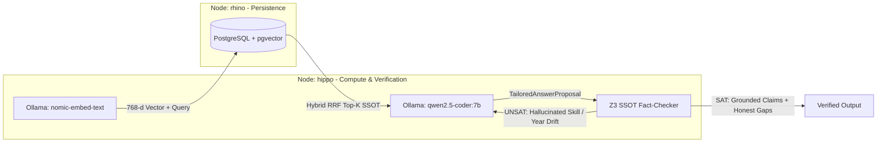

# interview-ops — Grounded Hybrid RAG & Z3 Fact-Checker


> **Change Management:** See [`CHANGELOG.md`](CHANGELOG.md) for formal Change Requests (`CR`), mitigated risks, and QA verification evidence.
Distributed pipeline for tailored CV generation with formal anti-hallucination guarantees. Combines hybrid retrieval (`pgvector` cosine distance + PostgreSQL `tsvector` Reciprocal Rank Fusion on `rhino`) with symbolic Z3 verification against a Single Source of Truth (SSOT) on `hippo`.

> Part of the [`sandbox-init`](https://github.com/spanskikh/sandbox-init) neuro-symbolic cluster. See [`docs/ARCHITECTURE.md`](https://github.com/spanskikh/sandbox-init/blob/main/docs/ARCHITECTURE.md) for system design and ADRs.

## Distributed Architecture (`hippo` <-> `rhino`)


## Factuality Invariants (Z3)
* **Referential Grounding:** Every generated `claim` must reference a valid `source_record_id` in the retrieved SSOT.
* **Chronological & Entity Lock:** Company name, `start_year`, and `end_year` must match the SSOT record identically.
* **Skill Subset Invariant:** Claimed skills must form a subset of that role's verified stack (`claimed_skills <= ssot.skills`); unverified requirements are separated into `missing_required_skills`.

## Sample CEGIS Execution
```text
Hybrid RRF Top-2 from rhino pgvector:
  - exp_deutsche_bank_2025 (Deutsche Bank (Berlin)) RRF=0.0164
  - exp_infineon_2024 (Infineon Technologies (Munich)) RRF=0.0161
CEGIS Converged: True in 2 iter(s)
  Verified Claims: ['exp_deutsche_bank_2025', 'exp_infineon_2024']
  Honest Skill Gaps: ['Kubernetes']
```

## MCP Tools (`FastMCP` / `stdio`)
* `hybrid_search_ssot` — Hybrid RRF search (`pgvector` cosine + `ts_rank_cd`) over SSOT experience records.
* `generate_verified_cv_claims` — Retrieves relevant experience and synthesizes Z3-verified CV claims.
* `audit_cv_proposal` — Standalone Z3 audit of generated resume claims against SSOT records.

## Quickstart & QA Gate
```bash
docker compose build rag-qa
docker compose run --rm rag-qa sh -c "ruff check src tests && mypy src tests && pytest -v"
docker compose run --rm rag-qa python -m interview_ops.cegis
```
