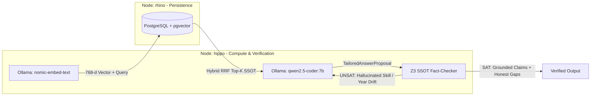

# interview-ops — Grounded Hybrid RAG & Z3 Fact-Checker

Распределённый конвейер генерации таргетированных резюме с формальной защитой от галлюцинаций. Объединяет гибридный поиск (`pgvector` + `tsvector` RRF на `rhino`) и символическую проверку утверждений против единого источника истины (SSOT) на `hippo`.

## Распределённая архитектура (`hippo` <-> `rhino`)



## Инварианты фактологической точности
* **Referential Grounding:** каждый `claim` обязан ссылаться на существующий `source_record_id` из SSOT.
* **Chronological & Entity Lock:** название компании, `start_year` и `end_year` проверяются на строгое равенство записи SSOT.
* **Skill Subset Invariant:** множество `claimed_skills` проверяется на включение в стек конкретного этапа опыта (`claimed <= SSOT`); неподтверждённые требования вакансии честно выносятся в `missing_required_skills`.

## MCP-инструменты (`FastMCP` / `stdio`)
* `hybrid_search_ssot` — гибридный поиск (Reciprocal Rank Fusion поверх cosine distance и `ts_rank_cd`) по базе опыта.
* `generate_verified_cv_claims` — извлечение релевантного опыта и синтез резюме с Z3-проверкой фактов.
* `audit_cv_proposal` — автономный Z3-аудит сгенерированных утверждений против SSOT.

## Запуск и QA-гейт
```bash
docker compose build rag-qa
docker compose run --rm rag-qa sh -c "ruff check src tests && mypy src tests && pytest -v"
docker compose run --rm rag-qa python -m interview_ops.cegis
```
